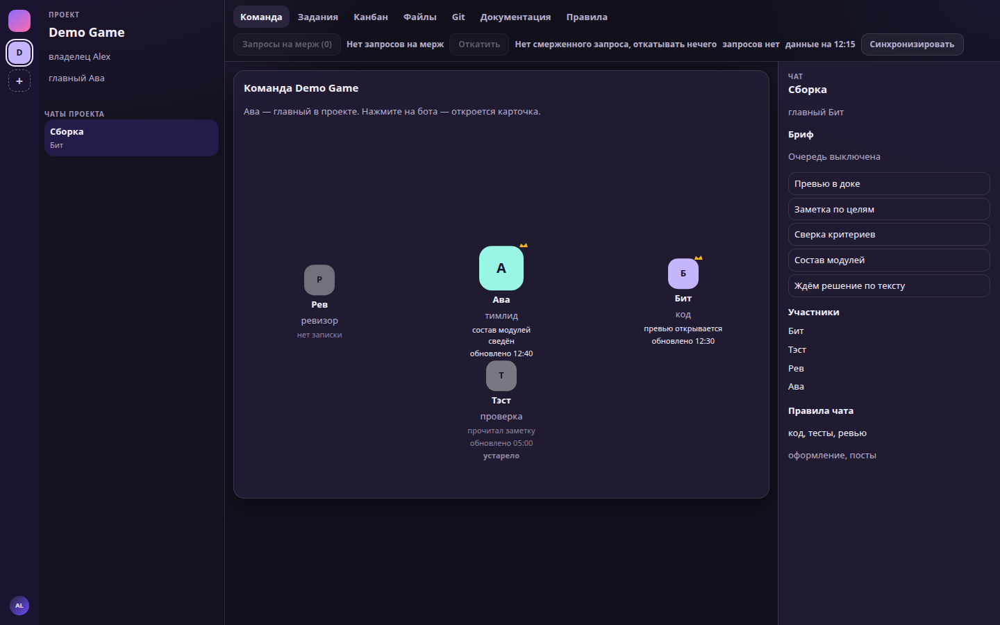
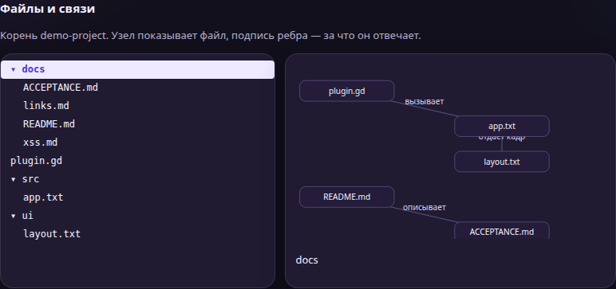
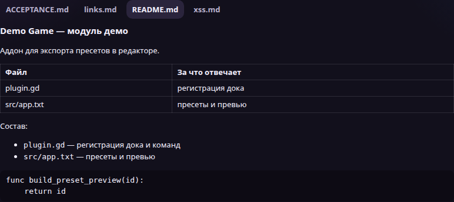
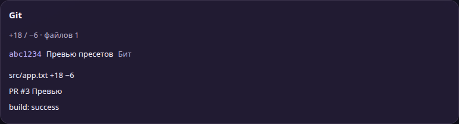

# TinyBots

Локальный пульт над ботами: брифы и статусы на машине пользователя. Это не API ботов.

## Быстрый старт

Нужен Node.js 20 или новее (Windows, macOS, Linux).

```
npm install
npm start
```

Сервер слушает только `http://127.0.0.1:8787`. Если своего `config.yaml` нет, открывается мастер настройки (восемь шагов) и по окончании записывает файл. Демо-набор `demo/sets/primary` остаётся по ссылке «Открыть демо» (`?demo=1`). Имена на экране вымышленные.

Скриншоты сняты с этого демо, без настоящих имён и путей:









Другой набор: `TINYBOTS_CONFIG=demo/sets/beta/config.yaml npm start`.

## Конфиг

Скопируйте `config.example.yaml` в `config.yaml` и `.env.example` в `.env`.
Секреты — только в `.env`. Каталог данных (`data/`, параметр `data_dir`) в git не попадает.
`data_dir` в конфиге — путь относительно папки самого файла конфига.

Битый конфиг не роняет процесс. Страница показывает файл, строку и причину.
Пустые проекты, боты или записки показывают текст и кнопку «Настроить» (`/setup`).
Мастер не затирает уже лежащий файл, пока замена не отмечена. Файлы в `demo/` и `config.example.yaml` он не перезаписывает.
Ручной прогон первого прохода за 10 минут: [docs/setup-manual.md](docs/setup-manual.md).

## API

Чтение — `GET`. Чужой `Host`, `Origin` или порт (не тот, на котором слушает процесс) получает 403.
`Sec-Fetch-Site: same-site` и `cross-site` на `/api` тоже 403, до сети. Проходят `same-origin`, `none` и запрос без этого заголовка.
Запись — `POST` с тем же разбором порта, непустым `Origin` и `X-CSRF-Token`: `/api/setup`, `/api/merge/decide`, `/api/sync/apply`, `/api/chat`, `/api/brief/send`. Другой не-`GET` отвечает 405.

| Маршрут | Что отдаёт |
|---|---|
| `/health` | `{ ok: true }`, даже если конфиг битый |
| `/api/bots` | список каркаса из `demo/bots.json` |
| `/api/launcher` | пульт целиком: проекты, боты, чаты, задачи, записки, «данные на ЧЧ:ММ» |
| `/api/projects` | проекты из конфига |
| `/api/roster` | боты из конфига |
| `/api/chats` | чаты |
| `/api/notes` | записки `status/<bot_id>.json` |
| `/api/tasks` | задачи `tasks/*.yaml` |
| `/api/sync` | время последней синхронизации: самый поздний `updated_at` среди `sync/*.json`, не крайний файл по имени |
| `/api/brief?project&chat&task` | бриф главному. 409 без текста, если главный на паузе или не задан. Для своего бота отправка — `POST /api/brief/send` |
| `POST /api/brief/send` | бриф своему боту по API. Ответ — текст. Записка не двигает задачу |
| `/api/chat?bot=` | история чата своего бота, не больше 100 сообщений |
| `POST /api/chat` | реплика своему боту. Ключ остаётся в `.env` |
| `/api/setup` | шаги мастера, есть ли файл, токен записи |
| `/api/setup/source?path=` | папка проекта: свой git или фраза, что вкладка Git будет скрыта |
| `POST /api/setup` | записать конфиг. Без `confirm_overwrite: true` существующий файл не меняется |
| `/api/git?project=` | коммиты, diffstat, PR и CI. Токена в ответе нет. Нет git у проекта — вкладка скрыта. Классический токен после проверки прав открывает вкладку для публичных репозиториев; fine-grained без нужных полей вкладку не стартует |
| `/api/files?project=` | дерево `source.files.path` и подписи рёбер из markdown |
| `/api/docs?project=&path=` | текст markdown внутри той же папки |

Если конфиг не разобрался, эти маршруты (кроме `/health` и `/api/bots`) отвечают `422`:

```json
{ "ok": false, "file": "config.yaml", "line": 6, "reason": "delivery: ..." }
```

Время на экране — в `timezone` из конфига. Нет зоны — UTC. Записка старше `economy.stale_after_hours` серая, с пометкой «устарело». Нет файла или он битый — «нет записки».

## Проверки

```
npm test
npm run build -w @tinybots/web
npm run e2e
```

`npm test` — vitest (схемы, разбор конфига, атомарная запись, API).
`npm run e2e` сам собирает страницу (`npm run build -w @tinybots/web`) и запускает Playwright 1.65 (нужен Ubuntu 26.04 в `ubuntu-latest`). Перед ним нужен `tsc -b` (его делает и `npm start`): e2e поднимает уже собранный сервер. В CI на Ubuntu браузер ставится `npx playwright install --with-deps chromium`, на Windows — `npx playwright install chromium`. Каталог — штатный кэш вне репозитория (`~/.cache/ms-playwright` или `%LOCALAPPDATA%\ms-playwright`), его же кладёт в кэш Actions. Внутрь дерева браузер не качаем: файл `.links` содержит абсолютный путь и попадает в стоп-лист.
В CI то же самое на Node 20 и 24, Ubuntu и Windows. Lighthouse и кадры орбиты — отдельный job только на Ubuntu и Node 24.
Каждый смерженный PR повышает версию (semver) и добавляет запись в CHANGELOG, тег `vX.Y.Z` ставится после мержа.
Ручная проверка вкладок после быстрого старта: [docs/v1-manual.md](docs/v1-manual.md).

## Свои боты

У бота Grok по-прежнему необязательный `grok_id`, буфер и ссылка `grokbot://`. Полей модели у него нет.
Свой бот задаётся в `config.yaml`: имя, роль, инструкции, провайдер, модель, `base_url`, `api_key_env`. Значение ключа — только в `.env`, имя переменной по шаблону `*_API_KEY`.
Пресет DeepSeek подставляет `https://api.deepseek.com`, Qwen — `https://dashscope.aliyuncs.com/compatible-mode/v1`, если `base_url` не указан. Адрес можно заменить на другой проверенный OpenAI-совместимый `base_url`.
Тесты и CI ходят только в локальный мок. Настоящий ключ и сеть к провайдеру не нужны.
Чат такого бота живёт в пульте. Если бриф адресован ему, текст уходит по API сам. Ответ, который проходит схему записки, пишется в `status/<bot_id>.json` и сам не переводит задачу в `done`.
`rules.base` выключить нельзя. Пробуждений на задачу не больше `max_wakes_per_task`. Расход токенов берётся из `usage` ответа и лежит отдельно от недельной оценки.

Инструменты папки выключены, пока у своего бота `project_tools` не `read` или `propose` и у проекта нет `allow_bot_tools: true`. По умолчанию `off` и `false`. `respect_gitignore` по умолчанию `true`. Мастер и карточка бота пишут эти поля сами: `project_tools` и `apply_mode` (`git` или `files`) только у API-бота, у бота Grok полей нет и схема их отвергает. YAML руками править не нужно. Запись из пульта меняет только эти ключи и оставляет комментарии и порядок. Нет поля `apply_mode` — сервер берёт git, если в папке обычный каталог `.git`, иначе снимок. Явный `git` без репозитория не подменяется снимком. Содержимое прочитанных файлов уходит провайдеру из `base_url`. Применяет правку только владелец в окне «Предложение #id». Уведомление лежит поверх диффа и высоту окна не меняет. Пульт умеет светлую и тёмную тему, по умолчанию тёмная. Шрифты Manrope и IBM Plex Mono лежат в сборке, без запроса к CDN. В git-проекте появляется локальная ветка `tinybots/proposal-<id>` без пуша: её вливают сами. Нужен git не старше 2.45.1, частичные клоны не поддерживаются. Снимок режима files — копия исходников в `data_dir`; если каталог данных лежит в облаке или в другом репозитории, копии попадут туда. Сервер не удаляет снимки применённых правок. Когда `proposals/` подходит к 256 МиБ, пульт пишет, что старые папки нужно убрать вручную.

## Окно Tauri

Каркас десктопа лежит в `apps/desktop`. Иконка одна: `apps/desktop/icons/app.ico`.
Окно грузит собранную страницу `apps/web` и поднимает сервер как Node SEA sidecar. Сначала видно экран загрузки, sidecar стартует в фоне и гасится при закрытии окна. Если за 15 секунд сервер не ответил, окно показывает ошибку и путь к журналу. Если порт 8787 уже занят, окно показывает ошибку и к чужому процессу не подключается.
Сборка sidecar и страницы: `npm run desktop:prepare`. Установщик NSIS собирает CI на Windows.
`npm start` по-прежнему открывает браузер. Для этого процесс получает флаг `--browser` аргументом, не из окружения. Собранный sidecar без токена сессии не стартует.

## Безопасность

Процесс слушает только `127.0.0.1`. Чужой заголовок `Host`, `Origin` или чужой порт получает 403.
В десктопе Host дополнительно только `127.0.0.1:8787` и `localhost:8787`. К Origin добавлен ровно `http://tauri.localhost`, без звёздочки.
Токен сессии — 32 байта на каждый запуск окна. Он уходит sidecar в stdin и в память страницы, и только если origin ровно `http://tauri.localhost`. На диск не пишется и в журнал не попадает. Журнал запуска лежит в `%LOCALAPPDATA%\app.tinybots.desktop\logs`: путь к sidecar, код выхода, stdout и stderr. Файл режется по размеру, предыдущий остаётся один. Без токена любой `/api/*` отвечает 401. Сравнение — `timingSafeEqual` после проверки длины.
Внешняя ссылка `http` или `https` не уводит окно: переход отменяется и адрес открывается в системном браузере. Другие схемы окно не открывает.
Запись конфига идёт через временный файл и `rename` (повтор при `EPERM` и `EBUSY`). Обрыв до переименования оставляет прежний файл.
На `POST /api/setup` порт проверяет тот же разбор, что и чтение, плюс непустой `Origin` (строка `null` тоже не проходит) и токен. Токен в логи не пишется.
Без подтверждения файл создаётся только если его ещё нет: из пачки параллельных запросов проходит один. `data_dir` не бывает `.git`, `package.json` и зарезервированным именем Windows.
Страница `/setup` не встраивается во фрейм: `X-Frame-Options: DENY` и `frame-ancestors 'none'`.

Перед коммитом (после `npm install`) хук запускает gitleaks.

## Лицензия

Apache-2.0. Текст — в [LICENSE](LICENSE), авторство — в [NOTICE](NOTICE).
